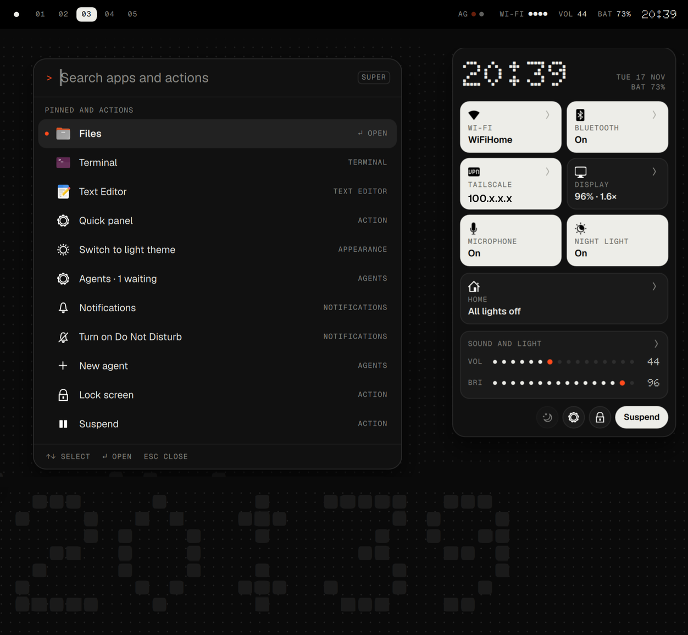

# Signal

[English](README.md) · **Italiano**

Un tema per [Omarchy](https://omarchy.org) su Hyprland che tratta lo schermo come uno
strumento di misura: superfici piene, valori e ora nel carattere a puntini, etichette in
monospazio e un solo colore di segnale per ciò che è attivo o ha bisogno di te.

Due varianti: **scura** (nero, bianco carta, segnale arancio-rosso) e **chiara** (palette Carta,
segnale blu inchiostro, ombre nette). La variante segue l'aspetto di sistema
(`org.gnome.desktop.interface color-scheme`) e con lei cambiano icone, colore d'accento GNOME,
bordo delle finestre e sfondo. L'interfaccia è in **italiano e inglese**.

Signal gira come istanza Quickshell separata (`qs -c macish`), accanto a `omarchy-shell`.
Nomi di cartelle e configurazione nel progetto usano ancora il nome di lavoro `macish`
(e `Segnale-*` per i temi di icone).

## Installazione

    git clone https://github.com/antoniopicone/hyprland-signal-theme.git && cd hyprland-signal-theme
    ./install.sh                    # oppure: ./install.sh --keep-omarchy-bar

L'installer fa un backup di ciò che sostituisce (`*.bak.<timestamp>`).

Requisiti: Omarchy (l'installer modifica la sua configurazione della shell e sostituisce i
plugin notifiche e OSD), Hyprland, `quickshell` 0.2+, Qt 6.9+, `gsettings`. Facoltativi:
`nmcli`, `wpctl`, `brightnessctl`, `bluetoothctl`, `hyprsunset`, `notify-send`; senza, i
relativi controlli non fanno nulla. I caratteri (Doto, Geist, Geist Mono) vengono scaricati dal
repository di Google Fonts.

## Cosa installa

| Dove | Cosa |
|---|---|
| `~/.config/quickshell/macish` | Barra, binario (dock), launcher, pannello rapido con pagine Wi-Fi / Bluetooth / Audio / Schermo / Tailscale / Casa, notifiche, OSD, sfondo a puntini con l'ora |
| `~/.config/hypr/macish.lua` o `macish.conf` | Angoli arrotondati, ombre, bordo, niente sfocatura, scorciatoie, tasti multimediali (Lua se usi `hyprland.lua`, altrimenti hyprlang) |
| `~/.local/share/icons/Segnale-Scuro`, `Segnale-Chiaro` | Temi di icone con cartelle Tinta, 80+ tipi di file, dispositivi, cestino (il resto da Yaru) |
| `~/.local/bin/agente`, `agente-hooks-claude` | Stato degli agenti per il pannello; installer degli hook per Claude Code |
| `~/.local/share/fonts/brina` | Doto, Geist, Geist Mono |
| `~/.config/omarchy/shell.toml` | Ritocchi a livello di sistema ai menu e pannelli di Omarchy (barra, testo, spaziatura, controlli senza bordo) |

L'installer disattiva anche i plugin notifiche e OSD di Omarchy e ne nasconde la barra
(`--keep-omarchy-bar` lascia la barra).

## Lingua

L'interfaccia segue `LANG` (`it_*` → italiano, altro → inglese). Per forzarla:
`readonly property string language: "it"` (o `"en"`) in `Config.qml` (default: `"auto"`).
Le traduzioni stanno in `I18n.qml`: le stringhe italiane nel codice fanno da chiave e
`I18n.t("testo")` restituisce la versione inglese. Per aggiungere una lingua basta un'altra
tabella. Anche `agente` segue `LANG` (o `MACISH_LANG`); i nomi dei suoi comandi restano in
italiano.

## Scorciatoie

| Tasti | Azione |
|---|---|
| Super + Spazio | Launcher |
| Super + Ctrl + C | Pannello rapido (anche clic su stato e ora nella barra) |
| Super + Ctrl + A | Agenti (anche clic su `AG` nella barra) |
| Super + Ctrl + M | Notifiche (anche clic sul pallino in alto a sinistra) |
| Super + Ctrl + N | Tema scuro / chiaro |
| Tasti volume, luminosità, microfono | OSD di Signal |

## Notifiche

Il pallino in alto a sinistra, prima dei workspace, è la spia delle notifiche:

- **pieno, colore del testo**: niente da leggere;
- **pieno, colore di segnale**: notifiche non lette;
- **solo contorno**: Non disturbare attivo (colore di segnale se nel frattempo è arrivato qualcosa).

Un clic apre il cassetto a sinistra: notifiche raggruppate per app (tre in vista, le altre con
"Altre N"), Cancella per gruppo o tutto, e Non disturbare in cima. Aprendolo, il pallino torna
del colore del testo. I banner compaiono in alto a sinistra, sotto la barra; con Non disturbare
passano solo quelli critici.

Regola dei colori: **colore di segnale fisso** = c'è qualcosa da leggere, **che lampeggia** =
qualcuno (un agente) aspetta te. Il colore di segnale è arancio-rosso nella variante scura e
blu in quella chiara.

Il cassetto, il pannello rapido, il menu Agenti e il binario delle app condividono la
curvatura del launcher (angoli da 20 px).

## Agenti

La barra mostra `AG` con un puntino per agente: **bianco che respira** = lavora, **colore di
segnale che lampeggia** = aspetta te, **grigio** = ha finito. Il numero del workspace dove sta
l'agente prende lo stesso puntino. Il pannello (clic su `AG`, o Super + Ctrl + A) elenca gli
agenti con cartella, workspace, tempo, ultima azione e attività degli ultimi 10 minuti.

Quando un agente chiede qualcosa:
- la spia lampeggia lenta (una volta al secondo) finché non apri il pannello o vai sulla sua
  finestra, poi resta fissa finché non rispondi;
- il bordo della sua finestra prende il colore di segnale;
- se aspetta da più di 5 minuti, ogni minuto la spia lampeggia veloce per qualche secondo;
- facoltativo: una notifica critica con "Vai al terminale" (passa anche con Non disturbare).
  È spenta di default: imposta `agentNotify: true` in `Config.qml`.

**Claude Code** è collegato da solo: l'installer aggiunge gli hook in `~/.claude/settings.json`
(con backup; salta il passo con `--no-claude-hooks`). Per toglierli: `agente-hooks-claude --rimuovi`.

**Altri agenti**: lanciali con `agente avvia codex -- codex` (o qualsiasi comando). Uno script
può segnalare un'attesa con `agente attende ID "messaggio"`. Tutto il resto: `agente --help`.

Le richieste di permesso si approvano nel terminale dell'agente: il pannello ti avvisa e ti ci
porta, ma non approva a distanza.

## Pannello Casa

Il riquadro Casa del pannello rapido parla con Home Assistant: indirizzo e token si leggono da
`~/.config/omarchy-home-control/config.json` (lo stesso file del plugin Home Control di
Omarchy). Senza, il riquadro dice "Non configurata".

## Personalizzare

`~/.config/quickshell/macish/Config.qml`:
- app fissate e parti da mostrare (`showBar`, `showWallpaper`, `wallpaperClock`), gestione di
  icone e accento (`manageIcons`, `manageAccent`), `language`;
- agenti: `agentBlink` (false = fisso, senza lampeggio), `agentNudgeAfter`, `agentNotify`,
  `agentWindowBorder`, `newAgentCommand`;
- comandi: le pagine Wi-Fi, Bluetooth, Audio, Schermo, Tailscale e Casa aprono i pannelli di
  dettaglio con `omarchy-shell shell summon …`. Alcuni id di plugin sono dell'autore
  (`antonio.menu`, `corico.monitor`, `antoniopicone.home-control`): cambiali con quelli che usi.

I colori sono in `Theme.qml`.

## Disinstallare

    ./uninstall.sh

Ripristina barra, notifiche e OSD di Omarchy e rimuove i file di Signal; i backup `.bak.*` e i
caratteri restano dove sono.

## Se qualcosa non va

- `qs -c macish log` mostra gli errori QML (l'avviso su `QtWebSockets` viene dal client Home
  Assistant del riquadro Casa).
- La barra di Omarchy è ancora visibile: `touch ~/.local/state/omarchy/toggles/bar-off && omarchy-restart-shell`.
- Notifiche doppie o assenti: `./replace-omarchy-osd.sh` e controlla `omarchy plugin list`.
- La spia degli agenti non si accende: controlla `agente lista` e che `~/.claude/settings.json`
  contenga gli hook.
- Il bordo della finestra attiva non cambia colore: con la configurazione Lua `hyprctl keyword`
  potrebbe non essere supportato.
