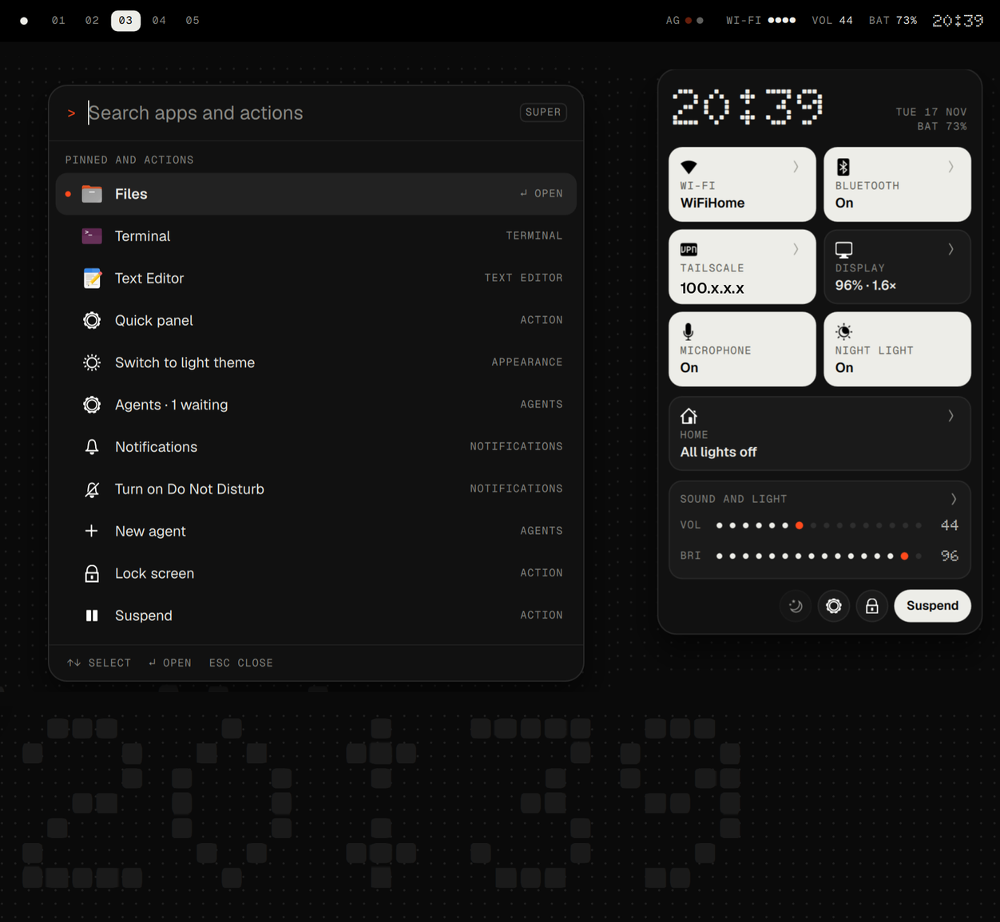

# macish · Signal theme

[Italiano](README.it.md) · **English**

The desktop as a measuring instrument: solid surfaces, values and time in a dot-matrix
typeface, monospaced labels and a single signal colour for whatever is active.
Two variants: **dark** (black, paper white, orange-red) and **light** (Paper palette,
ink blue, crisp shadows). The variant follows the system appearance
(`org.gnome.desktop.interface color-scheme`), and icons, GNOME accent colour, window
border and wallpaper change with it.

It runs as a separate Quickshell instance (`qs -c macish`), alongside `omarchy-shell`.
The interface is available in **English and Italian**.

## Installation

    unzip macish-segnale.zip && cd segnale
    ./install.sh                    # or: ./install.sh --keep-omarchy-bar

Requirements: `quickshell` 0.2+, Qt 6.9+, Hyprland. Optional: `nmcli`, `wpctl`,
`brightnessctl`, `bluetoothctl`, `hyprsunset`. Fonts (Doto, Geist, Geist Mono) are
downloaded from the Google Fonts repository.

If you had Brina installed, this package replaces it: to go back, just run Brina's
installer again.

## What it installs

| Where | What |
|---|---|
| `~/.config/quickshell/macish` | Bar, rail (dock), launcher, quick panel with Wi-Fi/Bluetooth/Audio, notifications, OSD, dot-matrix wallpaper with the time |
| `~/.config/hypr/macish.lua` or `macish.conf` | Corners, shadows, border, shortcuts, media keys (Lua if you use `hyprland.lua`) |
| `~/.local/share/icons/Segnale-Scuro`, `Segnale-Chiaro` | Icon themes with tinted folders, 80+ file types, devices, trash (the rest from Yaru) |
| `~/.local/bin/agente` | Agent status for the panel; hook for Claude Code |
| `~/.local/share/fonts/brina` | Doto, Geist, Geist Mono |
| `~/.config/omarchy/shell.toml` | Tweaks to the Omarchy menus |

The installer disables Omarchy's notification and OSD plugins and hides its bar.

## Language

The interface follows `LANG` (`it_*` → Italian, anything else → English). To force one,
set `readonly property string language: "en"` (or `"it"`) in `Config.qml`
(default: `"auto"`). Translations live in `I18n.qml`: the Italian strings in the code are
the keys, and `I18n.t("text")` returns the English version. Adding a language means adding
another table. The `agente` command follows `LANG` too (or `MACISH_LANG`); its command
names stay in Italian.

## Shortcuts

| Keys | Action |
|---|---|
| Super + Space | Launcher |
| Super + Ctrl + C | Quick panel (also click the status and time in the bar) |
| Super + Ctrl + A | Agents (also click `AG` in the bar) |
| Super + Ctrl + M | Notifications (also click the dot at the top left) |
| Super + Ctrl + N | Dark / light theme |
| Volume, brightness, microphone keys | Signal OSD |

## Notifications

The dot at the top left, before the workspaces, is the notification indicator:

- **filled, text colour**: nothing to read;
- **solid red**: unread notifications;
- **outline only**: Do Not Disturb is on (red if something arrived in the meantime).

A click opens the drawer on the left: notifications grouped by app (three visible, the
rest behind "N more"), Clear per group or all, and Do Not Disturb at the top. Opening it
turns the dot back to the text colour. Banners appear at the top left (not under Do Not
Disturb, except critical ones).

Colour rule: **solid red** = there is something to read, **blinking red** = someone (an
agent) is waiting for you.

The drawer, the quick panel, the Agents menu and the app rail share the launcher's curvature
(20 px corners).

## Agents

The bar shows `AG` with one dot per agent: **breathing white** = working,
**blinking red** = waiting for you, **grey** = done. The number of the workspace where the
agent lives gets the same red dot. The panel (click `AG`, or Super + Ctrl + A) lists the
agents with folder, workspace, elapsed time, last action and activity over the last
10 minutes.

When an agent asks for something:
- the indicator blinks slowly (once a second) until you open the panel or go to its
  window, then stays solid red until you answer;
- a critical notification with "Go to terminal" arrives (it also gets through Do Not Disturb);
- its window border turns red;
- if it has been waiting for more than 5 minutes, the indicator blinks fast for a few
  seconds every minute.

**Claude Code** is hooked up automatically: the installer adds the hooks to
`~/.claude/settings.json` (with a backup). To remove them: `agente-hooks-claude --rimuovi`.

**Other agents**: launch them with `agente avvia codex -- codex` (or any command).
A script can signal a wait with `agente attende ID "message"`.
Everything else: `agente --help`.

Permission requests are approved in the agent's terminal: the panel alerts you and takes
you there, but does not approve remotely.

## Customising

`~/.config/quickshell/macish/Config.qml`: pinned apps, parts to show (`showBar`,
`showWallpaper`, `wallpaperClock`), icon and accent handling, commands, `language`.
Agents: `agentBlink` (false = solid red), `agentNudgeAfter`, `agentNotify`,
`agentWindowBorder`, `newAgentCommand`.
Colours in `Theme.qml`.

## Uninstalling

    ./uninstall.sh

## Troubleshooting

- `qs -c macish log` shows QML errors.
- Omarchy's bar is still visible: `touch ~/.local/state/omarchy/toggles/bar-off && omarchy-restart-shell`.
- Duplicate or missing notifications: `./replace-omarchy-osd.sh` and check `omarchy plugin list`.
- The agent indicator doesn't light up: check `agente lista` and that `~/.claude/settings.json`
  contains the hooks.
- The active window border doesn't change colour: with the Lua configuration `hyprctl keyword`
  may not be supported.
